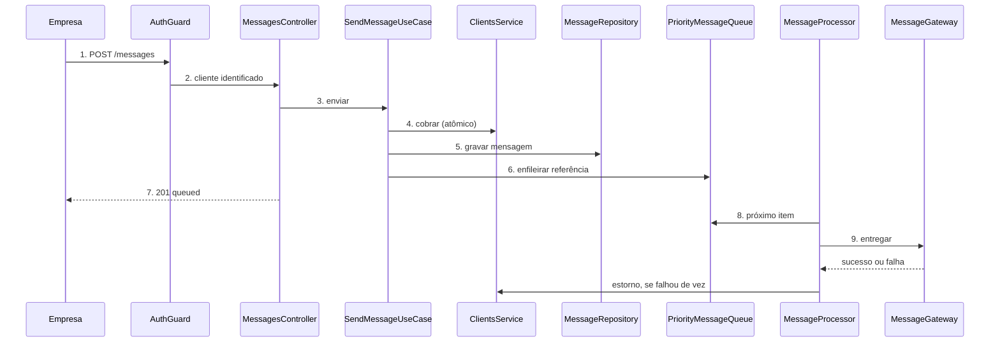
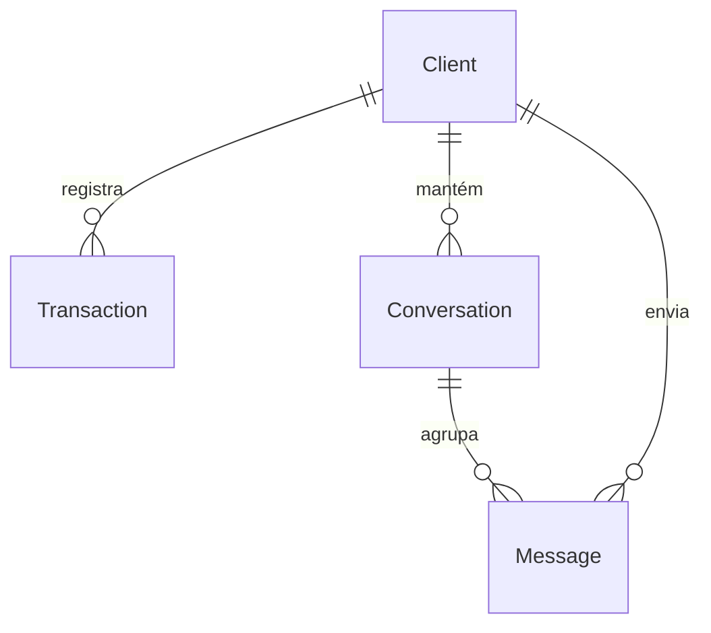
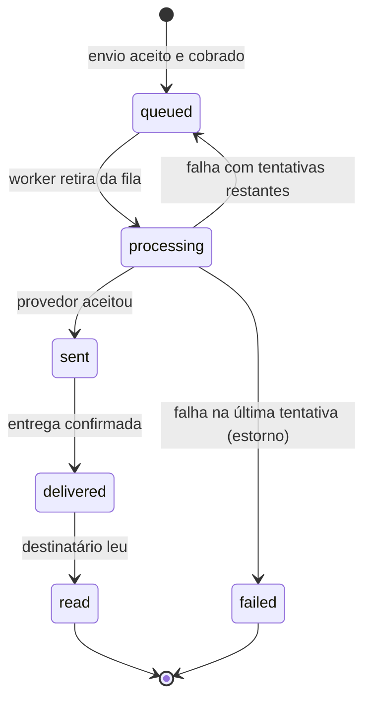

# Fila de mensagens com prioridade (Big Chat Brasil)

**Approved**: 2026-11-18 - user: "1 - Confirmado 2 - confirmado 3 - pode seguir assim 4 - ok 5 - Ok 6 - Não vamos fazer frontend então, menos complicação"

## Problem

Empresas clientes do Big Chat Brasil pagam por mensagem enviada aos seus destinatários, em plano pré-pago (saldo) ou pós-pago (limite mensal). Hoje não existe um serviço que receba esses envios, cobre o valor certo de cada um e decida a ordem em que saem. Sem isso, três coisas dão errado ao mesmo tempo: uma mensagem pode sair sem ter sido paga, uma mensagem urgente espera atrás de centenas de normais, e, quando se passa a priorizar as urgentes, uma mensagem normal já paga pode nunca sair se as urgentes não pararem de chegar. O enunciado do desafio (ver `Sources`) descreve o problema, lista entidades, endpoints e custos, e pesa a avaliação em estrutura de dados (30%), APIs e validações (25%), regras de negócio (20%), organização (15%) e performance (10%). Ele não traz números de volume.

Quando isto estiver no ar, uma empresa se identifica pelo CPF/CNPJ, envia mensagens normais (R$ 0,25) ou urgentes (R$ 0,50), é cobrada antes de a mensagem entrar na fila, vê as urgentes saírem primeiro sem que as normais fiquem presas, acompanha o status de cada mensagem até a entrega e recebe o valor de volta se a entrega falhar de vez.

## Shape

Não há sistema anterior: nada é reaproveitado e nada é duplicado. As regras que mudam um resultado rodam em código sem framework, alcançado diretamente pelos testes unitários: a cobrança em `clients/domain`, a máquina de estados em `messaging/domain` e a ordem de saída em `messaging/queue`.

1. `POST /messages` com `Authorization: Bearer` ou `X-Client-Document` -> `AuthGuard` (new) - identifica o cliente pela API pública de `clients`
2. `MessagesController` (new) - valida o corpo e entrega ao caso de uso
3. `SendMessageUseCase` (new) - confere o destino sem gravar nada e, depois da cobrança, cria a `Message` em `queued`
4. `ClientsService` (new) - debita o custo e registra a transação em uma única operação atômica, persiste `Client` e `Transaction` (door 1)
5. `MessageRepository` (new) - persiste `Message`, a única gravação depois da cobrança; `Conversation` é obtida ou criada antes dela (door 1)
6. `PriorityMessageQueue` (new) - recebe a referência da mensagem no nível da sua prioridade
7. out: resposta 201 com identificador, status, custo e saldo atual, no contrato de erro e sucesso da door 2
8. `MessageProcessor` (new) - retira da fila na ordem decidida por ela e move a mensagem para `processing`
9. `MessageGateway` (new) - entrega ao provedor; sucesso leva a `sent` e `delivered`; falha volta à fila ou, esgotadas as tentativas, leva a `failed` com estorno em `ClientsService`

**Changes underneath**

| Front | What changes |
| --- | --- |
| domain | nada muda de significado: o sistema é novo e ninguém ramifica sobre termos existentes |
| stored data | nada a migrar: o esquema nasce com esta entrega |
| readers | o Swagger e o script de demonstração leem o contrato HTTP desta entrega |

New: `Client`, `Transaction`, `Conversation`, `Message` e as quatro relações acima. One-way constraints: documento do cliente único, valores monetários em centavos inteiros (door 1).

## Surface

| Route | In | Out | Status | Who |
| --- | --- | --- | --- | --- |
| `POST /auth` | `documentId`, `documentType` | `token`, `client` | `200`, `400`, `401` | anyone |
| `GET /clients` | - | lista de clientes | `200` | anyone |
| `POST /clients` | `name`, `documentId`, `documentType`, `planType`, `balance?`, `limit?` | cliente | `201`, `400`, `409` | anyone |
| `GET /clients/:id` | - | cliente | `200`, `404` | anyone |
| `PUT /clients/:id` | `name?`, `active?`, `limit?`, `planType?` (converte o plano) | cliente | `200`, `400`, `404` | anyone |
| `GET /clients/:id/balance` | - | `planType`, `balance` ou `limit` e `used`, `available` | `200`, `404` | anyone |
| `POST /clients/:id/credits` | `amount` | saldo atualizado | `201`, `400`, `404` | anyone |
| `GET /clients/:id/transactions` | - | histórico financeiro | `200`, `404` | anyone |
| `GET /conversations` | - | conversas com `unreadCount` | `200`, `401` | cliente autenticado; os demais recebem `401` |
| `GET /conversations/:id` | - | conversa | `200`, `401`, `404` | dono da conversa; sem credencial `401`, outro cliente `404` |
| `GET /conversations/:id/messages` | - | mensagens em ordem cronológica | `200`, `401`, `404` | dono da conversa; sem credencial `401`, outro cliente `404` |
| `POST /messages` | `conversationId?`, `recipientId?`, `recipientName?`, `content`, `priority?` | `id`, `conversationId`, `status`, `estimatedDelivery`, `cost`, `currentBalance?` | `201`, `400`, `401`, `402`, `403`, `404` | cliente autenticado e ativo; sem credencial `401`, inativo `403` |
| `GET /messages` | `status?`, `priority?`, `conversationId?` | mensagens do cliente | `200`, `400`, `401` | cliente autenticado; os demais recebem `401` |
| `GET /messages/:id` | - | mensagem | `200`, `401`, `404` | remetente; sem credencial `401`, outro cliente `404` |
| `GET /messages/:id/status` | - | `status`, `attempts`, `history` | `200`, `401`, `404` | remetente; sem credencial `401`, outro cliente `404` |
| `PATCH /messages/:id/read` | - | `status`, `history` | `200`, `401`, `404`, `409` | remetente; sem credencial `401`, outro cliente `404` |
| `GET /queue/status` | - | tamanhos por nível, contadores, anti-starvation, worker | `200` | anyone |
| `GET /health` | - | `status` | `200` | anyone |

## Landing

| One-way door | Literal shape | Alternative rejected |
| --- | --- | --- |
| 1. Esquema persistido no PostgreSQL | tabelas `clients_client`, `clients_transaction`, `messaging_conversation`, `messaging_message`; dinheiro em `*_cents BIGINT`; `document` com `UNIQUE`; `status` e `priority` como `TEXT` com `CHECK` | `NUMERIC`/`FLOAT` para dinheiro - o domínio trabalha em centavos inteiros e a conversão em cada leitura reintroduz o erro que a decisão evita ([ADR-005](../../../docs/adr/005-dinheiro-em-centavos.md)); ORM com entidades anotadas - esconde o lock do débito ([ADR-007](../../../docs/adr/007-postgres-com-sql-direto.md)) |
| 2. Formato de erro do contrato HTTP | `{ "statusCode": 402, "code": "INSUFFICIENT_BALANCE", "message": "...", "details": { } }` com `code` estável em maiúsculas | corpo padrão do framework (`message` e `error` livres) - o cliente teria de interpretar texto para distinguir saldo insuficiente de limite excedido |
| 3. Dependência do driver `pg` | `import { Pool } from 'pg'` restrito a `src/**/infra/postgres/` | TypeORM ou Prisma - para quatro tabelas acrescentam camada de mapeamento e geração de código sem reduzir o SQL que importa ([ADR-007](../../../docs/adr/007-postgres-com-sql-direto.md)) |

- Nothing else in this change is hard to reverse

## Criteria

### S1: Clientes e autenticação (P1)

Uma empresa é cadastrada com documento válido, consulta saldo ou limite e se identifica para usar as rotas protegidas.

**Acceptance Criteria**

1. WHEN `POST /clients` recebe `name`, `documentId` válido, `documentType` e `planType` THEN the system SHALL responder `201` com `id`, `documentId` só com dígitos, `active: true` e `balance` (pré-pago) ou `limit` (pós-pago)
   - `529.982.247-25` → `documentId: "52998224725"`; CNPJ `11.222.333/0001-81` → `"11222333000181"`
2. IF o documento tem dígito verificador errado, tamanho errado, todos os dígitos iguais ou tipo trocado THEN the system SHALL responder `400` com `code: "INVALID_DOCUMENT"`
   - `52998224724` → 400; `11111111111` → 400; um CPF válido enviado como `CNPJ` → 400
3. IF já existe cliente com o mesmo documento THEN the system SHALL responder `409` com `code: "DOCUMENT_ALREADY_REGISTERED"`
4. IF o corpo traz campo não declarado, `planType` fora de `prepaid|postpaid`, `documentType` fora de `CPF|CNPJ` ou `balance`/`limit` negativo THEN the system SHALL responder `400` sem criar cliente
5. WHEN `GET /clients/:id/balance` é chamado THEN the system SHALL responder `200` com `{ planType, balance, available }` para pré-pago e `{ planType, limit, used, available }` para pós-pago, em reais
   - pós-pago com limite 50,00 e consumo 42,50 → `available: 7.5`
6. IF `:id` não existe em `GET /clients/:id`, `PUT /clients/:id`, `/balance`, `/credits` ou `/transactions` THEN the system SHALL responder `404` com `code: "CLIENT_NOT_FOUND"`
7. WHEN `PUT /clients/:id` recebe `name`, `active` ou `limit` THEN the system SHALL responder `200` com o cliente atualizado; WHEN recebe `planType` diferente do atual THEN the system SHALL converter o plano preservando o saldo residual e o consumo pendente
   - pré-pago com saldo 3,00 convertido com `limit: 10` → passa a consumir o limite; reconvertido → `balance: 3` de volta
   - converter para pós-pago um cliente sem limite → `400` com `code: "LIMIT_REQUIRED"`
   - estorno de mensagem cobrada antes da conversão é creditado, nunca perdido
8. WHEN `POST /clients/:id/credits` recebe `amount` maior que zero THEN the system SHALL somar o valor ao saldo, registrar uma transação `credit` e responder `201`
   - `amount: 5.5` sobre saldo 10,00 → 15,50; `amount: 0` → `400`; valor acima de R$ 1 bilhão → `400`
9. WHEN `POST /auth` recebe o documento de um cliente cadastrado THEN the system SHALL responder `200` com `token` e `client`
   - documento válido não cadastrado → `401`; documento inválido → `400`
10. WHILE a requisição não traz `Authorization: Bearer <token válido>` nem `X-Client-Document` de cliente cadastrado, the system SHALL responder `401` com `code: "UNAUTHORIZED"` em toda rota de `/messages` e `/conversations`
11. The system SHALL guardar todo valor monetário em centavos inteiros e expor em reais com até duas casas
    - 0,10 + 0,20 → 0,30 exato; saldo 10,00 menos cinco mensagens normais → 8,75

### S2: Envio com cobrança (P1)

Uma mensagem só entra na fila depois de paga, e ninguém vê o que é de outro cliente.

**Acceptance Criteria**

12. WHEN um cliente pré-pago ativo com saldo maior ou igual ao custo chama `POST /messages` THEN the system SHALL responder `201` com `id`, `conversationId`, `status`, `estimatedDelivery`, `cost` e `currentBalance`, debitar o custo, registrar uma transação `debit` com o `messageId` e colocar a mensagem na fila
    - saldo 1,00, mensagem normal → `cost: 0.25`, `currentBalance: 0.75`
    - mecanismo: saldo e transação são gravados na mesma operação atômica (`ClientRepository.mutate` com o lançamento)
13. The system SHALL cobrar R$ 0,25 por mensagem `normal` e R$ 0,50 por mensagem `urgent`, tratando `priority` ausente como `normal`
14. IF o saldo do pré-pago é menor que o custo THEN the system SHALL responder `402` com `code: "INSUFFICIENT_BALANCE"` sem debitar, sem gravar mensagem, sem criar conversa e sem enfileirar
    - saldo 0,25 e mensagem normal → aceita, saldo 0,00; saldo 0,24 → 402
15. WHEN um cliente pós-pago envia THEN the system SHALL somar o custo ao consumo do mês e responder `201` sem `currentBalance`; IF consumo mais custo excede o limite THEN the system SHALL responder `402` com `code: "LIMIT_EXCEEDED"`
    - limite 0,60: urgente → aceita (`used: 0.5`); normal em seguida → 402; consumo exatamente igual ao limite → aceita
16. WHEN o mês corrente (UTC) é diferente do mês do último consumo THEN the system SHALL contar o consumo do pós-pago a partir de zero
    - limite todo consumido em janeiro → em 1º de fevereiro `available` é o limite inteiro
17. IF o cliente está inativo THEN the system SHALL responder `403` com `code: "CLIENT_INACTIVE"` ao enviar, sem debitar e sem criar conversa
18. IF `content` está vazio ou só tem espaços, `priority` não é `normal|urgent`, ou faltam `conversationId` e `recipientId` THEN the system SHALL responder `400` sem debitar
    - sem conversa e sem destinatário → `code: "RECIPIENT_REQUIRED"`
19. WHEN o envio traz `recipientId` sem `conversationId` THEN the system SHALL usar a conversa existente daquele cliente com o destinatário ou criar uma; IF `conversationId` pertence a outro cliente THEN the system SHALL responder `404` sem debitar
20. IF gravar a mensagem ou enfileirar falha depois da cobrança THEN the system SHALL estornar o custo com uma transação `refund`, responder `500` com `code: "INTERNAL_ERROR"` e não deixar mensagem pendente
    - mecanismo: compensação em `SendMessageUseCase.execute`; a mensagem é a única gravação depois da cobrança
21. WHEN dez envios de R$ 0,25 do mesmo cliente com saldo R$ 1,00 são disparados ao mesmo tempo THEN the system SHALL aceitar exatamente quatro e recusar seis com `402`, terminando com saldo 0,00
    - mecanismo: `ClientRepository.mutate` lê, decide e grava sob lock da linha do cliente
22. IF um cliente pede mensagem ou conversa de outro cliente THEN the system SHALL responder `404`, igual ao de um id inexistente
23. WHEN `GET /messages` recebe `status`, `priority` ou `conversationId` THEN the system SHALL devolver só as mensagens do cliente autenticado que atendem aos filtros
    - `status=inexistente` → `400`
24. WHEN `GET /conversations` é chamado THEN the system SHALL listar as conversas do cliente, da mais recente para a mais antiga, com `recipientName`, `lastMessageContent`, `lastMessageTime` e `unreadCount` igual ao número de mensagens `delivered` ainda não lidas
25. WHEN `PATCH /messages/:id/read` é chamado para uma mensagem `delivered` THEN the system SHALL movê-la para `read` e responder `200`
    - chamar de novo → `409` com `code: "INVALID_STATUS_TRANSITION"`

### S3: Fila com prioridade e proteção contra starvation (P1)

As urgentes saem primeiro, e toda mensagem normal tem um limite de espera que se pode demonstrar.

**Acceptance Criteria**

26. The fila SHALL entregar as mensagens de um mesmo nível na ordem em que chegaram
27. WHEN há mensagens urgentes e normais na fila THEN the fila SHALL entregar as urgentes antes das normais
    - entram `n1, u1, n2, u2` com `URGENT_BURST=10` → saem `u1, u2, n1, n2`
28. WHILE há mensagem normal esperando, the fila SHALL entregar no máximo `URGENT_BURST` (padrão 3) urgentes consecutivas antes de entregar uma normal
    - `URGENT_BURST=2`, entram `n1, n2, u1, u2, u3, u4, u5` → saem `u1, u2, n1, u3, u4, n2, u5`; com o padrão 3 → `u1, u2, u3, n1, u4, u5, n2`
    - `URGENT_BURST=2`: três urgentes saem com a fila normal vazia; então chegam `n1, u4, u5, u6` → saem `u4, u5, n1, u6` (a rajada só conta com normal esperando)
29. IF a fila está vazia THEN the fila SHALL devolver "nada" sem lançar erro e continuar aceitando novos itens
30. The fila SHALL enfileirar e desenfileirar em tempo constante
    - com 100.000 itens, a fila é pelo menos cinco vezes mais rápida do que a mesma fila feita com array e `shift()`, medidas na mesma execução
31. IF `URGENT_BURST` não é um inteiro maior ou igual a 1 THEN the fila SHALL recusar a configuração com `RangeError`
    - na inicialização: `URGENT_BURST`, `MAX_ATTEMPTS`, `RETRY_BACKOFF_MS`, `PROCESSING_DELAY_MS` ou `QUEUE_MODE` inválidos interrompem a subida da aplicação com mensagem que nomeia a variável

### S4: Processamento, falhas e reinício (P2)

A requisição não espera a entrega; falhas passageiras se resolvem sozinhas e falhas definitivas devolvem o dinheiro.

**Acceptance Criteria**

32. WHILE `QUEUE_MODE=async`, WHEN um envio é aceito THEN the system SHALL responder com `status: "queued"` e levar a mensagem a `delivered` sem nenhuma nova requisição
33. WHILE `QUEUE_MODE=sync`, WHEN um envio é aceito THEN the system SHALL concluir a tentativa de entrega antes de responder
    - uma mensagem aguardando nova tentativa com `RETRY_BACKOFF_MS` maior que zero responde `queued`
    - uma falha de infraestrutura durante o processamento não transforma em erro a resposta de um envio já cobrado
34. The mensagem SHALL mudar de status apenas por `queued→processing→sent→delivered→read`, `processing→queued` e `processing→failed`, registrando cada mudança com horário em `history`
    - `GET /messages/:id/status` de uma mensagem entregue → `history` com `queued, processing, sent, delivered`
35. IF a entrega falha e a mensagem tem menos de `MAX_ATTEMPTS` (padrão 3) tentativas THEN the system SHALL devolvê-la a `queued` e reenfileirá-la no fim do seu nível após `RETRY_BACKOFF_MS × 2^(tentativa−1)`
    - provedor falha duas vezes e aceita na terceira → `delivered`, `attempts: 3`, `retried: 2`
36. IF a entrega falha na tentativa de número `MAX_ATTEMPTS` THEN the system SHALL mover a mensagem para `failed` e estornar o custo com uma transação `refund` ligada ao `messageId`
    - pré-pago com saldo 1,00 envia urgente que sempre falha (`MAX_ATTEMPTS=2`) → `failed`, `attempts: 2`, saldo de volta a 1,00
    - o estorno acontece antes do registro de `failed` e no máximo uma vez por mensagem, mesmo que o tratamento da falha seja repetido após uma queda
37. WHEN o consumo da fila é disparado várias vezes ao mesmo tempo THEN the system SHALL entregar cada mensagem uma única vez e na ordem decidida pela fila
    - mecanismo: laço único de consumo (`MessageProcessor.drain` compartilha a execução em andamento)
    - IF gravar o resultado falha depois de o provedor aceitar THEN a mensagem não é reenviada nem estornada: falha de persistência não é falha de entrega
38. WHEN a aplicação inicia com `PERSISTENCE=postgres` e existem mensagens `queued` ou `processing` THEN the system SHALL devolvê-las a `queued` e reenfileirá-las pela ordem de criação

### S5: Operação e demonstração (P2)

Quem opera enxerga a fila, e quem avalia vê o sistema funcionando sem ler código.

**Acceptance Criteria**

39. WHEN `GET /queue/status` é chamado THEN the system SHALL responder `200` com `size { urgent, normal, total }`, `enqueued`, `processed`, `failed`, `retried`, `averageWaitMs`, `antiStarvation { urgentBurst, preventions }` e `worker { mode, running }`
40. IF a requisição é recusada ou falha, por qualquer motivo, THEN the system SHALL responder com o corpo `{ statusCode, code, message, details? }`
    - regra de negócio → `code` do domínio; formato inválido → `VALIDATION_FAILED`; rota inexistente → `NOT_FOUND`; JSON malformado → `BAD_REQUEST`; erro inesperado → `INTERNAL_ERROR`, sem detalhe interno
41. WHEN `GET /docs` é aberto THEN the system SHALL mostrar a documentação OpenAPI com todas as rotas da seção Surface, o corpo de cada resposta e os status de erro de cada rota
42. WHEN `scripts/demo.sh` é executado contra a API no ar THEN o script SHALL criar um cliente, enviar duas mensagens normais e cinco urgentes, imprimir a ordem de entrega `u1 u2 u3 n1 u4 u5 n2`, e terminar mostrando um envio recusado com `402` e `code: "INSUFFICIENT_BALANCE"`

## Out of scope

| Excluded | Why |
| --- | --- |
| Fila persistente ou broker externo (Redis, RabbitMQ, Kafka) | o enunciado pede fila em memória e avalia a estrutura de dados; a reconstrução no boot cobre o reinício ([ADR-004](../../../docs/adr/004-fila-em-memoria-com-anti-starvation.md)) |
| Cache | com quatro tabelas e consultas por chave não há leitura cara a aliviar; a estratégia está descrita em `docs/architecture.md` |
| JWT, OAuth, papéis de usuário | o FAQ do enunciado dispensa; o CRUD de clientes fica como API administrativa aberta ([ADR-009](../../../docs/adr/009-autenticacao-simples.md)) |
| Idempotência em `POST /messages` (`Idempotency-Key`) | não pedida; registrada como limitação conhecida no README. O estorno, este sim, é idempotente por mensagem |
| Paginação das listagens | volumes do desafio não exigem; limitação registrada |
| Faturamento do pós-pago (fechar o mês e cobrar o consumo) | as regras citam consumo e limite, não fatura; o consumo do mês fica consultável em `/balance` |
| Envio real por provedor externo | o FAQ pede simulação; `MessageGateway` é a porta para um provedor futuro |
| Interface web (front) | o perfil escolhido é backend; o autor decidiu não incluir: "Não vamos fazer frontend então, menos complicação". A demonstração é feita pelo Swagger e por `scripts/demo.sh` |
| Notificação em tempo real (WebSocket/SSE) | o status é consultado em `GET /messages/:id/status` |
| Métricas em formato Prometheus, tracing | `/queue/status` e logs cobrem o que o enunciado pede |

## Assumptions

| Assumption | Chosen default | Rationale | Confirmed? |
| --- | --- | --- | --- |
| Persistência | PostgreSQL para clientes, transações, conversas e mensagens; fila em memória | enunciado prefere PostgreSQL e pede fila em memória | y |
| Demonstração | Swagger em `/docs` e `scripts/demo.sh`, sem front | autor: "Não vamos fazer frontend então, menos complicação" | y |
| Idioma da documentação | português, com identificadores em inglês | enunciado e empresa são brasileiros | y |
| Regra numérica do anti-starvation | 1 normal após 3 urgentes consecutivas, configurável por `URGENT_BURST` | o enunciado exige proteção e não dá número; a regra é determinística e tem limite demonstrável | y |
| Mensagem que falha de vez | custo estornado | o enunciado não diz; cobrar por serviço não prestado é indefensável | y |
| Fuso do "mês" do pós-pago | UTC | o enunciado não cita fuso; UTC evita ambiguidade entre servidor e cliente | n |
| Cliente inativo | autentica e consulta, mas não envia (`403`) | o enunciado só define o campo `active` | n |
| Criação de conversa | nasce no primeiro envio para um destinatário | o request do enunciado traz `conversationId` e `recipientId` e não há rota para criar conversa | n |
| `read` e `unreadCount` | `PATCH /messages/:id/read` simula a leitura pelo destinatário; não lidas = entregues ainda não lidas | o enunciado lista o status e o contador, mas só a empresa envia | n |
| Posição da mensagem em retry | fim do seu nível de prioridade | não bloqueia quem está atrás enquanto o provedor falha | n |

**Open questions:** none - all resolved or logged above.

## Differences from the source

| Source shows | Product shows | Confirmed |
| --- | --- | --- |
| Linguagens sugeridas: Java, Node.js ou Go | Node.js com NestJS e TypeScript | y - [AD-001](../../STATE.md) |
| Lista de endpoints sem rotas de crédito, histórico financeiro ou leitura | acrescenta `POST /clients/:id/credits`, `GET /clients/:id/transactions`, `PATCH /messages/:id/read` e `GET /health` | y - [AD-011](../../STATE.md) |
| Regras citam "manter histórico de transações" e "adicionar créditos" sem contrato | contrato definido pelas rotas acima | y - [AD-011](../../STATE.md) |
| Anti-starvation exigido sem regra | rajada de 3 urgentes para 1 normal, configurável | y - [AD-004](../../STATE.md) |
| Estados descritos: enfileirada, processando, enviada, falha (e, na Parte 2, entregue e lida) | os seis estados, com `processing→queued` para retry | y - [AD-008](../../STATE.md) |
| Não diz se a mensagem com falha é cobrada | estorno com transação `refund` | y - [AD-006](../../STATE.md) |
| Regras pedem "converter entre planos (com tratamento de saldo residual ou consumo pendente)" sem dizer qual tratamento | `PUT /clients/:id` com `planType` converte sem destruir nada: saldo residual e consumo pendente ficam na conta e voltam a valer na reconversão; estorno que não tem consumo a abater vira crédito | y - [AD-013](../../STATE.md) |
| Regras citam "tipo (SMS/WhatsApp)" na mensagem; a entidade `Message` do `backend.md` não tem esse campo | sem campo de tipo: o contrato segue o `backend.md`, e o tipo não altera custo, prioridade nem fila | y - [AD-014](../../STATE.md) |

## Sources

- [docs/backend.md](https://github.com/irrahgroup/irrah-tech-challenges/blob/main/docs/backend.md) (lido em 2026-11-17) - binding - partes do desafio, entidades, endpoints, pesos da avaliação
- [docs/regras-negocio.md](https://github.com/irrahgroup/irrah-tech-challenges/blob/main/docs/regras-negocio.md) (lido em 2026-11-17) - binding - custos, ordem de validação por plano, estados
- [docs/requisitos-tecnicos.md](https://github.com/irrahgroup/irrah-tech-challenges/blob/main/docs/requisitos-tecnicos.md) (lido em 2026-11-17) - binding - requisitos mínimos de entrega, Docker, README
- [docs/dicas.md](https://github.com/irrahgroup/irrah-tech-challenges/blob/main/docs/dicas.md) (lido em 2026-11-17) - binding - FAQ: autenticação simples, fila em memória aceita, envio simulado
