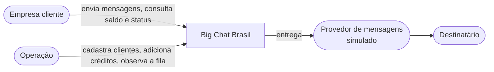
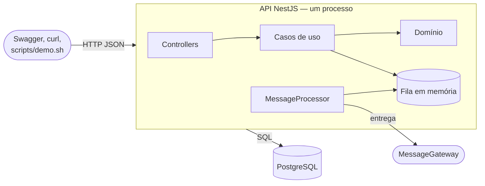
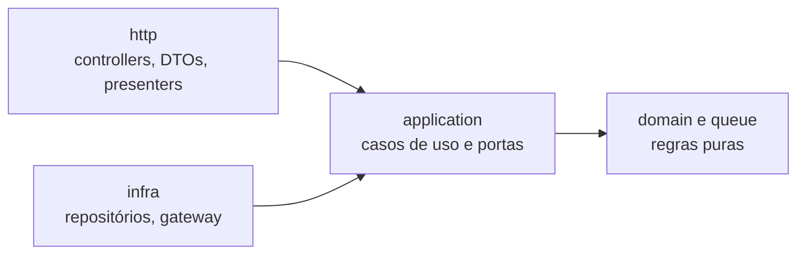
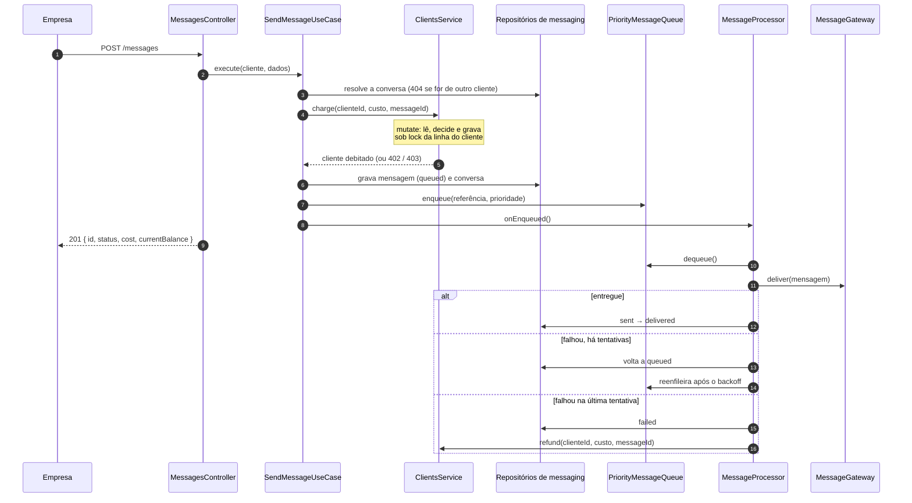
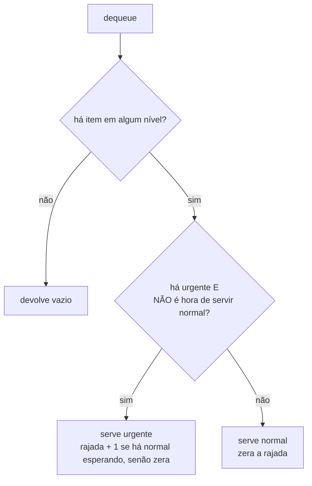
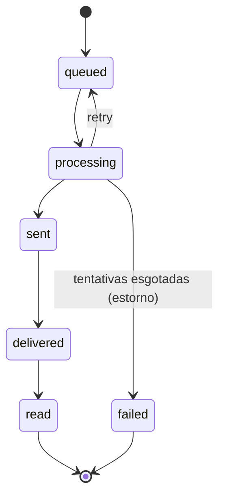
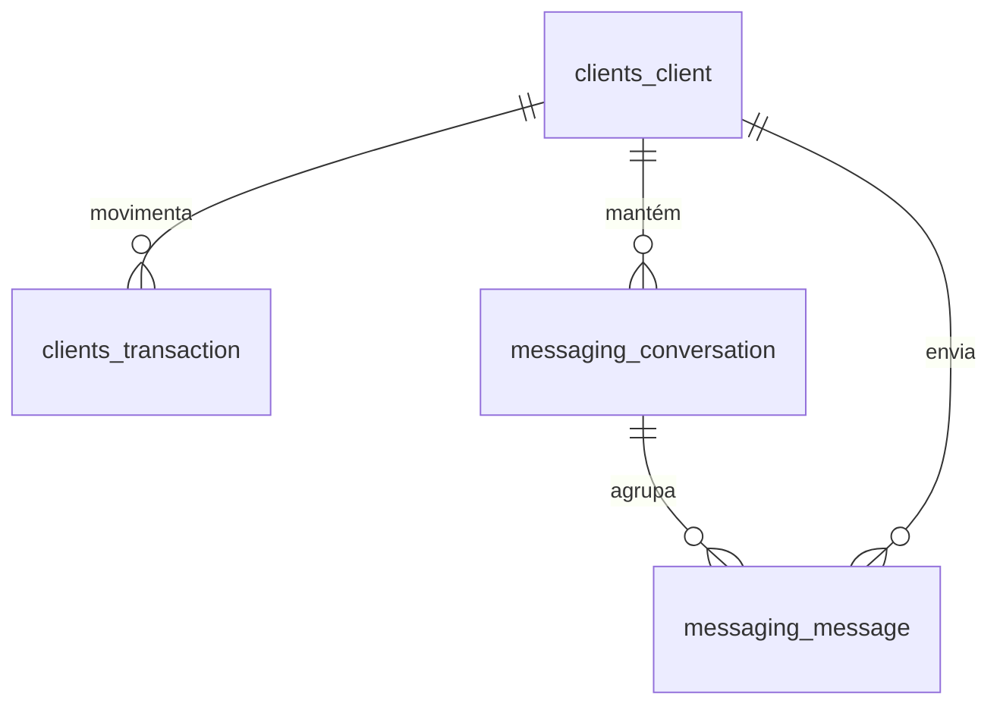

# Arquitetura

Este documento descreve como o Big Chat Brasil está organizado e por quê. As decisões têm um ADR cada em [`docs/adr/`](adr/); os requisitos estão em [`.specs/features/message-queue/plan.md`](../.specs/features/message-queue/plan.md).

## 1. Contexto



Uma empresa paga por mensagem enviada. O sistema cobra, enfileira por prioridade e entrega. O provedor de mensagens é simulado, como o enunciado permite.

## 2. Containers



| Container | Responsabilidade | Decisão |
|---|---|---|
| API NestJS | contrato HTTP, regras, fila e worker no mesmo processo | [ADR-001](adr/001-nestjs-com-typescript.md), [ADR-008](adr/008-worker-no-processo-com-retry.md) |
| PostgreSQL | clientes, transações, conversas, mensagens | [ADR-007](adr/007-postgres-com-sql-direto.md) |
| Fila em memória | ordem de processamento | [ADR-004](adr/004-fila-em-memoria-com-anti-starvation.md) |

## 3. Módulos e camadas

```
src/
  main.ts            sobe o servidor
  app.setup.ts       configuração global (validação, filtro de erros), usada também pelos testes
  app.module.ts
  shared/            Money, erros de domínio, Clock, guard, filtro
  clients/           quem paga: Client, Document, planos, transações, autenticação
    index.ts         ← API pública do módulo: o único arquivo que `messaging` importa
    domain/  application/  infra/{memory,postgres}/  http/
  messaging/         o que é enviado: Message, Conversation, fila, worker
    domain/  queue/  application/  infra/{memory,postgres}/  http/
```



**Regra da dependência.** As setas só apontam para o domínio. `domain/` e `queue/` não importam NestJS, `pg`, nem as outras camadas. As interfaces de repositório (portas) ficam em `application/ports.ts`, do lado de quem as usa; `infra/` as implementa; o `*.module.ts` é o único lugar que liga porta a implementação.

**Fronteira entre módulos.** `messaging` depende de `clients` em um ponto: cobrar e estornar. Usa para isso o que `src/clients/index.ts` exporta. Não há acesso cruzado a repositório nem a tabela.

Ambas as regras são verificadas por [`test/architecture.spec.ts`](../test/architecture.spec.ts).

## 4. O envio de uma mensagem



Pontos de decisão, na ordem em que aparecem:

1. Validações que não custam dinheiro vêm antes da cobrança.
2. A cobrança é uma operação atômica do repositório, não uma leitura seguida de escrita ([ADR-006](adr/006-cobrar-antes-de-enfileirar.md)).
3. Se gravar ou enfileirar falhar depois da cobrança, o valor é estornado.
4. O caso de uso não sabe se o processamento é síncrono ou assíncrono: ele avisa o processador, que decide pelo `QUEUE_MODE`.

## 5. A fila



"Hora de servir normal" = há normal esperando **e** a rajada de urgentes chegou a `URGENT_BURST`.

| Propriedade | Garantia |
|---|---|
| Custo | `enqueue` e `dequeue` em O(1): duas listas ligadas com ponteiro de cauda |
| Ordem | FIFO dentro de cada nível |
| Prioridade | urgente sai antes de normal |
| Justiça | a normal da frente espera no máximo `URGENT_BURST` urgentes |
| Vazão mínima das normais | `1 / (URGENT_BURST + 1)` sob enxurrada de urgentes |

A fila não tem dependência alguma e é genérica (`PriorityMessageQueue<T>`). Ela guarda referências; o estado das mensagens está no repositório.

## 6. Estados da mensagem



As transições permitidas estão em uma única tabela (`TRANSITIONS` em `messaging/domain/message.ts`), e só `Message.transitionTo` muda o status. Uma transição fora da tabela é erro de domínio (`409`).

## 7. Dados



- Dinheiro em centavos (`BIGINT`), documento único por cliente ([ADR-005](adr/005-dinheiro-em-centavos.md)).
- `messaging_*` referencia o cliente por identificador, sem chave estrangeira entre módulos.
- `clients_transaction` liga cada débito e estorno ao `messageId`: é o rastro para auditoria e reconciliação.
- A fila **não** é persistida; com PostgreSQL ela é reconstruída na inicialização a partir das mensagens `queued` e `processing`.

## 8. Modelagem tática: o que é rico e o que é dado

| Elemento | Tipo | Por quê |
|---|---|---|
| `Client` | aggregate | protege a cobrança (ativo? tem fundos conforme o plano?) |
| `PrepaidPolicy`, `PostpaidPolicy` | strategy | cada plano responde a cobrar, estornar e disponível; plano novo é classe nova |
| `Money`, `Document` | value objects | impossíveis de existir inválidos |
| `Message` | aggregate | máquina de estados e custo fixado na criação |
| `PriorityMessageQueue`, `LinkedQueue` | estruturas de dados | ordem e justiça |
| `Conversation`, `Transaction` | dados | não têm regra própria |
| `ClientsService`, `SendMessageUseCase`, `MessagesService`, `MessageProcessor` | serviços de aplicação | orquestram; não decidem regra de negócio |

Detalhes em [ADR-003](adr/003-ddd-tatico-seletivo.md).

## 9. Erros

O domínio lança `DomainError` com uma categoria (`kind`) e um código estável (`code`). Um único filtro traduz a categoria para o status HTTP:

| `kind` | Status | Exemplos de `code` |
|---|---|---|
| `validation` | 400 | `INVALID_DOCUMENT`, `RECIPIENT_REQUIRED`, `VALIDATION_FAILED` (formato da requisição) |
| `unauthorized` | 401 | `UNAUTHORIZED` |
| `payment_required` | 402 | `INSUFFICIENT_BALANCE`, `LIMIT_EXCEEDED` |
| `forbidden` | 403 | `CLIENT_INACTIVE` |
| `not_found` | 404 | `CLIENT_NOT_FOUND`, `MESSAGE_NOT_FOUND` |
| `conflict` | 409 | `DOCUMENT_ALREADY_REGISTERED`, `INVALID_STATUS_TRANSITION` |

## 10. O que não foi feito, de propósito

O critério foi o tamanho real do problema: cerca de 40 arquivos de produção, dois módulos, uma dependência entre eles, nenhum service com mais de seis dependências.

| Não há | Motivo |
|---|---|
| CQRS, barramento de eventos, eventos de domínio | uma chamada direta à API pública de `clients` resolve a única integração |
| Outbox e broker | a fila em memória é requisito; o custo (janela de queda) está no [ADR-006](adr/006-cobrar-antes-de-enfileirar.md) |
| ORM e entidades de persistência separadas | quatro tabelas, SQL à vista ([ADR-007](adr/007-postgres-com-sql-direto.md)) |
| Classe de caso de uso por operação | só o envio tem orquestração que justifique classe própria |
| Cache | nenhuma leitura cara; a decisão de saldo nunca poderia ler de cache |
| Circuit breaker, métricas Prometheus, tracing | uma dependência externa simulada; `/queue/status` e logs bastam |

**Como o cache entraria**, se houver motivo: como decorator do repositório de clientes (cache-aside com TTL curto para a busca por documento feita a cada requisição autenticada), invalidado na escrita. A aplicação não saberia que ele existe.

## 11. Como isso escalaria

O desenho atual é um processo. Para crescer, na ordem:

1. **Mais de uma instância da API**: a fila e as sessões saem da memória. Duas filas em um broker (por exemplo BullMQ ou SQS), com um consumidor aplicando a mesma regra de rajada; sessões em armazenamento compartilhado ou token assinado.
2. **Garantia contra queda entre cobrar e enfileirar**: transação única (débito, transação financeira, mensagem, linha de outbox) e um publicador que alimenta a fila a partir do banco.
3. **Reenvio do cliente**: cabeçalho `Idempotency-Key`.
4. **Vazão**: workers separados da API, com concorrência de I/O; ordem preservada por conversa, não global.
5. **Operação**: tempo de espera por prioridade em percentis, com objetivo explícito (por exemplo, urgente em até 5 s, normal em até 30 s), que passa a calibrar `URGENT_BURST`.

Nada disso é necessário para o que o desafio pede, e cada item troca simplicidade por uma garantia específica.
